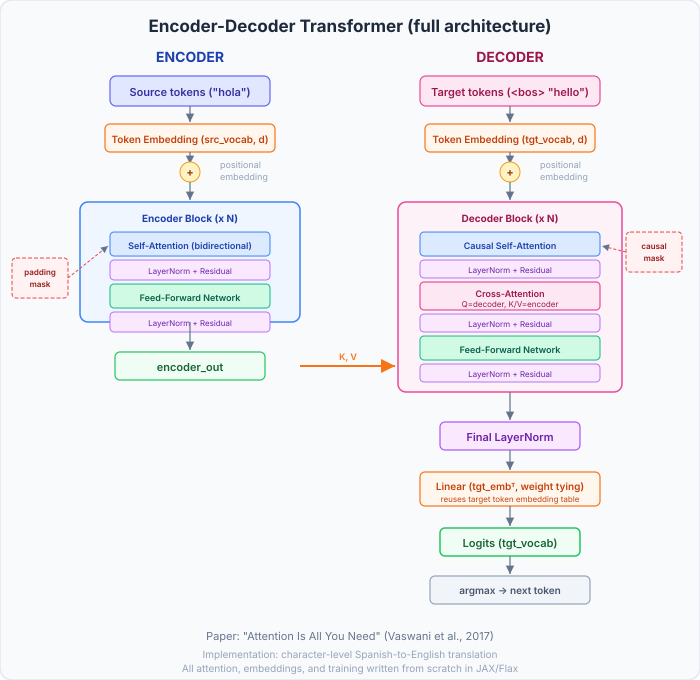
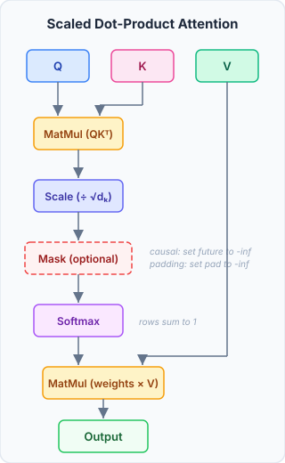
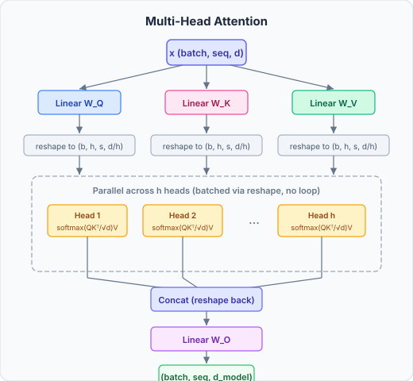
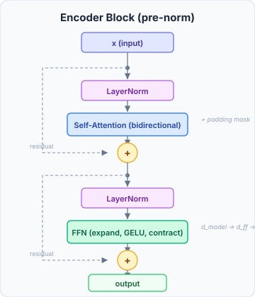
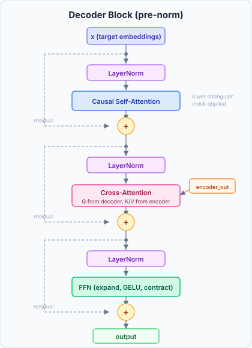
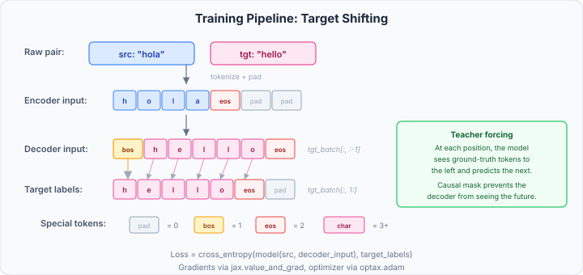

# jax-transformer

I built a Transformer from scratch in JAX/Flax to actually understand what's going on under the hood. No pre-built attention layers. Every matrix multiply, every mask, every residual connection is hand-written in raw `jax.numpy`. I wanted to be able to derive each step on a whiteboard, not just call someone else's library.

This follows the original ["Attention Is All You Need"](https://arxiv.org/abs/1706.03762) paper (Vaswani et al., 2017). It includes a **decoder-only** model for next-token prediction and a full **encoder-decoder** model that translates Spanish to English at the character level.

## Architecture

<p align="center">
  
</p>

The encoder reads the entire source sentence at once (bidirectional self-attention, so every token can see every other token). The decoder generates the translation one token at a time. It uses causal self-attention so it can only look at tokens it has already produced, and cross-attention to read the encoder's output. That cross-attention is the bridge between the two languages.

### Scaled Dot-Product Attention

This is the core building block. The whole model is built on top of this one operation:

$$\text{Attention}(Q, K, V) = \text{softmax}\left(\frac{QK^T}{\sqrt{d_k}}\right)V$$

<p align="center">
  
</p>

The diagram runs real numbers through one head with 5 tokens, so you can follow a single row from scores to output. The intuition: Q asks "what am I looking for?", K answers "what do I contain?", and V carries the actual information. The dot product between Q and K tells us how relevant each token is to every other token. We scale by `1/sqrt(d_k)` because without it the dot products get large and softmax saturates, killing the gradients. Masking is optional: the decoder uses a causal (lower triangular) mask to prevent cheating, and padding masks handle variable-length inputs.

### Multi-Head Attention

Instead of running one big attention, we split `d_model` into `num_heads` smaller attention heads. Each head has dimension `head_dim = d_model / num_heads` and can learn to focus on different things. Maybe one head learns word order while another learns which adjective goes with which noun.

<p align="center">
  
</p>

The split and concat are just reshapes, no loops needed. After concatenating all the heads back together, the `W_O` projection mixes information across heads into the final output.

### Encoder Block

Each encoder block has two sublayers with pre-norm residual connections:

<p align="center">
  
</p>

**Self-attention** here is bidirectional: the encoder can see the full source sentence in both directions. The **feed-forward network** is a simple two-layer MLP (expand to `d_ff` with GELU, then contract back to `d_model`) applied independently at each position. **Residual connections** let gradients skip over sublayers so they don't vanish in deep networks. I used **pre-norm** (LayerNorm before each sublayer) rather than the original post-norm because it trains more stably. GPT-2 and most modern Transformers do the same.

### Decoder Block

Each decoder block has three sublayers, each with its own residual connection:

<p align="center">
  
</p>

**Causal self-attention** uses a lower-triangular mask so the decoder can only see tokens to the left. This is what makes autoregressive generation work. **Cross-attention** is where the decoder reads from the encoder: queries come from the decoder, keys and values come from the encoder output. The **feed-forward network** has the same structure as the encoder's.

### Training Pipeline

The target sequence gets shifted by one position for teacher forcing:

<p align="center">
  
</p>

During training, the decoder sees the ground-truth tokens as input and learns to predict the next one at each position. At inference time, it feeds its own predictions back in, generating one token at a time until it produces `<eos>`.

## Project Structure

```
src/jaxtransformer/
  attention.py   # scaled dot-product, multi-head (self, cross, causal)
  embedding.py   # token embeddings + learned positional embeddings
  block.py       # layer norm, FFN, encoder block, decoder block
  model.py       # Flax modules: EncoderDecoderTransformer, DecoderTransformer
  data.py        # character tokenizers, batching, padding
  train.py       # cross-entropy loss, train loops, generation, translation
tests/           # 22 tests for shapes, masking, gradients, causality, end-to-end
assets/          # diagrams (the 3D and matrix ones come from make_diagrams.py)
```

## Design Decisions

| Decision | Why |
|---|---|
| Character-level tokenizer | Simplest possible tokenization. No BPE or sentencepiece dependency. Keeps the focus on the Transformer itself. |
| Pre-norm (LayerNorm before sublayers) | Trains more stably than the original post-norm. This is what GPT-2 and most modern Transformers use. |
| Weight tying | The output projection reuses the target embedding table (`logits = x @ embedding.T`). Saves `vocab_size * d_model` parameters and works well in practice. |
| Separate embedding tables | Source and target languages have different character sets, so they each get their own lookup table. |
| Greedy decoding for translation | Just `argmax` at each step. Simple, deterministic, and good enough for this scale. The decoder-only model uses temperature sampling for more varied generation. |
| Learned positional embeddings | Simpler than sine/cosine positional encoding and just as effective at this scale. |

## Setup

```bash
pip install -e ".[dev]"
pytest
```

Requires Python 3.10+. Runs on CPU, no GPU needed.

## Training

### Decoder-only (next-token prediction)

Train on a text file:

```bash
python train_example.py data.txt --epochs 10
```

Or run with the built-in example text:

```bash
python train_example.py
```

### Encoder-decoder (translation)

```python
from jaxtransformer.train import train_translation, translate

pairs = [
    ("hola", "hello"),
    ("gato", "cat"),
    ("perro", "dog"),
    ("casa", "house"),
]

params, model, src_tok, tgt_tok = train_translation(
    pairs, num_epochs=30, d_model=64, num_heads=4, num_layers=2, d_ff=256,
)

print(translate(model, params, src_tok, tgt_tok, "hola"))
# -> hello
```

## Results and limitations

Trained on a subset of the Tatoeba Spanish-English corpus (about 140k pairs, filtered to short sentences), a ~1.4M-parameter model running on CPU learns sentence structure and translates short, common full sentences reasonably well:

```
es: no me gusta este...   -> en: i don't like this ...
es: mi casa               -> en: my house
es: quiero a mi madre.    -> en: ... my mother
```

But it clearly struggles, and the failures are worth understanding because they are inherent to the design choices, not bugs:

- **Character-level tokenization is the main bottleneck.** The model has to learn three hard things at once: how to spell English words, which Spanish word maps to which English word, and word order. Spelling one character at a time produces made-up words like "friendshation" or "mom mother loves". Every production translation system avoids this with subword tokenization, so the model rearranges chunks instead of spelling.
- **Short fragments are out of distribution.** Almost every training pair is a full sentence ending in punctuation, so bare inputs like `hola` or `amigo` are unlike anything the model saw and it does worse on them than on full sentences.
- **It is deliberately small.** 1.4M parameters on CPU, trained on a fraction of the data for a few minutes, is orders of magnitude below what real neural machine translation uses.

The point of this project is a correct, from-scratch implementation and a clear understanding of every component, not a state-of-the-art BLEU score. The honest result is "right structure on short sentences, with known and explainable failure modes."

## Future improvements

In rough order of expected impact:

- **Word-level or subword (BPE) tokenization.** The single highest-impact change. Treating `casa` as one token instead of four characters removes the spelling burden entirely and makes the alignment problem far easier. Subword tokenization (BPE or SentencePiece) is the standard choice because it keeps the vocabulary bounded while still handling rare words.
- **Sinusoidal positional encoding.** Swap the learned positional embeddings for the fixed sine/cosine scheme from the paper, which generalizes to sequence lengths not seen during training.
- **Beam search decoding.** Replace greedy `argmax` with beam search to reduce the compounding of early mistakes during generation.
- **Label smoothing.** Soften the one-hot targets (as in the original paper) to reduce overconfidence and improve generalization.
- **Encoder-output caching at inference.** The current `translate()` re-runs the encoder on every decode step; caching it once per sentence is a straightforward speedup.
- **GPU training on the full corpus.** Larger `d_model`, more layers, and the complete dataset, which only becomes practical off CPU.

## Stack

- [JAX](https://github.com/jax-ml/jax) for array ops, automatic differentiation (`jax.value_and_grad`), and JIT compilation (`jax.jit`)
- [Flax](https://github.com/google/flax) for stateless `nn.Module` wrappers (`init` creates params, `apply` runs the forward pass)
- [Optax](https://github.com/google-deepmind/optax) for the Adam optimizer
- [pytest](https://docs.pytest.org/) with 22 tests covering shapes, masking, gradients, causality, and end-to-end training
